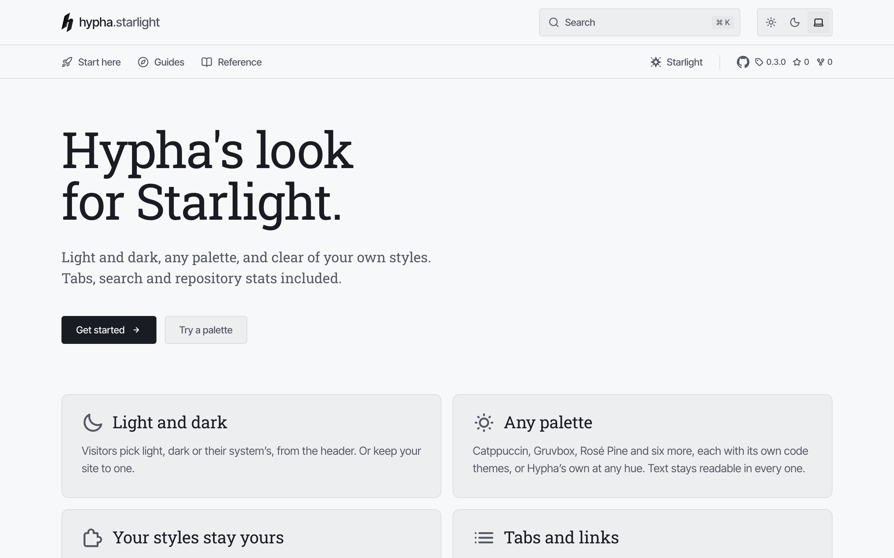

# starlight-theme-hypha

[](https://github.com/hyphatech/starlight-theme-hypha/tags)
[](https://github.com/hyphatech/starlight-theme-hypha/actions/workflows/docs.yml)
[](https://starlight.astro.build)
[](https://tailwindcss.com)
[](LICENSE)

Hypha's look for [Starlight](https://starlight.astro.build).

- **Light and dark**, following the visitor's system or set by you
- **Ten palettes**, each with its own code themes, readable in both schemes
- **Clear of your own styles**: prefixed classes and variables in their own
  cascade layer
- **Tabs, search and repository stats** included

📖 **[Documentation and live demo](https://hyphatech.github.io/starlight-theme-hypha/)**

<picture>
  <source media="(prefers-color-scheme: dark)" srcset=".github/screenshot-dark.png">
  
</picture>

## Getting started

1. Install the theme:

   ```sh
   bun add github:hyphatech/starlight-theme-hypha#v0.5.0
   ```

2. Add it to `plugins` in your `astro.config.mjs`:

   ```js
   import { defineConfig } from "astro/config";
   import starlight from "@astrojs/starlight";
   import starlightThemeHypha from "starlight-theme-hypha";

   export default defineConfig({
     integrations: [
       starlight({
         title: "docs",
         logo: { dark: "./src/assets/mark.svg", light: "./src/assets/mark-dark.svg" },
         plugins: [starlightThemeHypha({ palette: "catppuccin", brand: "acme" })],
       }),
     ],
   });
   ```

3. Run `bun run dev` and open <http://localhost:4321>.

## Options

| Option | Default | Description |
|---|---|---|
| `palette` | `"hypha"` | `hypha`, `catppuccin`, `rose-pine`, `gruvbox`, `everforest`, `kanagawa`, `solarized`, `github`, `night-owl` or `vitesse`, each with its own code themes. [Try them](https://hyphatech.github.io/starlight-theme-hypha/colours/) |
| `scheme` | `"auto"` | The scheme a visit starts in: `"auto"` follows the visitor's system, or `"dark"` or `"light"` |
| `themeSelect` | `true` | The header's control for changing the scheme; `false` hides it |
| `brand` | none | Shown before the title: `"acme"` with the title `"docs"` reads `acme.docs` |
| `search` | `true` | Search in the header; `false` also turns off Pagefind |
| `github` | none | `owner/name`, linked with its version, stars and forks; `{ repo, stats: false }` for the link alone |
| `tabs` | `false` | The sidebar's top-level groups as tabs: `true`, or an icon per group label |
| `links` | `[]` | Links beside the tabs: `{ label, href, icon? }` |

The docs cover [colours](https://hyphatech.github.io/starlight-theme-hypha/colours/),
[the header](https://hyphatech.github.io/starlight-theme-hypha/header/),
[landing pages](https://hyphatech.github.io/starlight-theme-hypha/landing-pages/)
and [customising](https://hyphatech.github.io/starlight-theme-hypha/customising/)
in full.

## With your own styles

Classes and variables are prefixed, `hypha:` and `--hypha-`, and the styles
sit in the `hypha` cascade layer, after Starlight's and before yours, so your
Tailwind or design system is left alone. If you declare your own layer order,
put `hypha` after `starlight`:

```css
@layer base, starlight, hypha, theme, components, utilities;
```

## Contributing

See [AGENTS.md](AGENTS.md) for the commands, the layout and the rules the
code keeps.

## Licence

MIT. Copyright Hypha Technologies Ltd. See [LICENSE](LICENSE).
